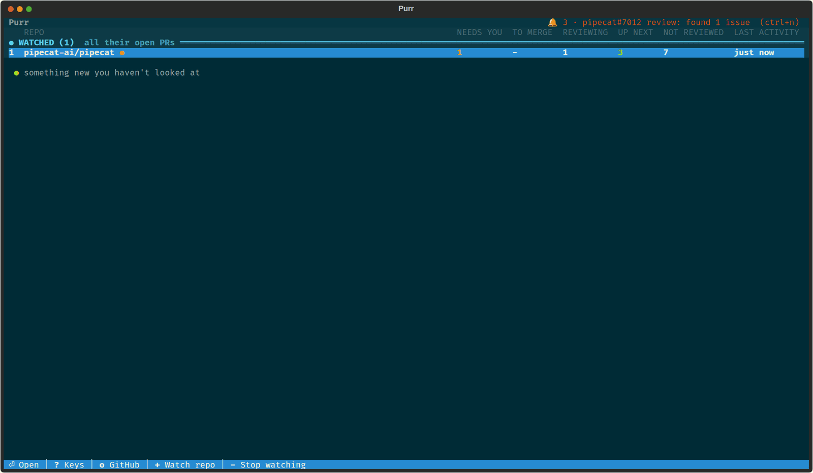

<h1><div align="center">
 
</div></h1>

[](https://pypi.org/project/pipecat-ai-purr) [](https://github.com/pipecat-ai/purr/actions/workflows/tests.yaml) [](https://discord.gg/pipecat)

# ᓚᘏᗢ Purr

Purr reviews the GitHub pull requests assigned to you, with Claude, in the background. You
read what it found, ask it questions, and decide what to post. Purr posts nothing on its own.

It was first built to help review the pull requests sent to
[Pipecat](https://github.com/pipecat-ai/pipecat).



## ✨ What it does

- Reviews the PRs assigned to you, a few at a time. Small changes get a quick review, risky
  ones a full one.
- Suggests what to review next, from the PRs nobody has taken.
- Helps with your own PRs: when someone comments, it checks what they said and proposes
  what to change and what to reply.
- Groups your PRs by what they need from you.
- Lets you talk to the agent about each PR, and comment on lines of the diff.
- Posts reviews, pushes changes and merges, one key each, as you.
- Follows several repos at once.
- Asks before doing anything risky, and can run in a sandbox.

## 🚀 Setup

You need macOS, Linux or Windows, [uv](https://docs.astral.sh/uv/), the
[GitHub CLI](https://cli.github.com) and git. You don't need Claude Code.

```sh
uv tool install pipecat-ai-purr
gh auth login    # GitHub
purr login       # Claude (skip it if you use Claude Code)
purr
```

Reviews count against your Claude plan, or your API key if you set `ANTHROPIC_API_KEY`.
To look around without starting reviews, run `purr --no-auto-review`.

## 🧭 How to use it

1. Pick a repo (`enter`, or its number). `+` adds another repo to watch.
2. Pick a PR. *Up next* lists a few PRs nobody has taken, and why.
3. `r` reviews it. PRs assigned to you are reviewed without asking.
4. Read the review and the diff (`d`). Ask the agent anything (`enter`).
5. Decide with the keys the box above the prompt shows: `a` posts the review, `x`
   dismisses it. Once you've approved, `m` merges.

You can also ask the agent to change the PR. It commits the change and proposes a push, and
`a` pushes it. If you ask it to rebase the PR, `a` force-pushes it, but only if nobody pushed
to the PR since.

### The PR list

| Group | What's in it |
|---|---|
| *Needs you* | Something to decide: a review to post, a question from the agent, a reply to you |
| *Reviewing* | The agent is reviewing it |
| *Your PRs* | PRs you opened |
| *Up next* | A few PRs nobody has taken, picked for you |
| *Review requested* | PRs asking for your review |
| *Done* | PRs you approved or requested changes on |
| *Others reviewing* | PRs someone else has taken |
| *Not reviewed* | The other open PRs |

### Deciding

| The box shows | `a` | `x` |
|---|---|---|
| A review the agent proposes | Post it, as you | Dismiss it |
| A push the agent proposes | Push it | Dismiss it |
| A command the agent wants to run | Allow it once (`A`: always) | Deny it |
| A reply to you on GitHub | | It needs no answer |
| No verdict from you yet | Approve the PR | |

## ⌨️ Keys

The footer shows the keys for where you are. `?` lists all of them.

| Key | Does |
|---|---|
| `enter` | Ask the agent |
| `tab` | Switch between the list and the PR |
| `n` / `p` | Next / previous PR |
| `/` | Search |
| `o` | Open on GitHub |
| `r` | Review the PR |
| `space` | Mark several PRs, then `r` reviews them all |
| `s` | Skip a PR in *Up next* |
| `a` / `x` / `A` | Accept / dismiss / always allow, as the box says |
| `m` | Merge: once to check, again to merge |
| `d` | The diff |
| `D` | The diff in your pager |
| `t` | The agent's reasoning in full |
| `z` | Full screen |
| `!` | A shell in the PR's checkout |
| `c` | The PR's session in Claude Code |
| `ctrl+p` | Find any repo or PR |
| `ctrl+n` | The latest news |
| `i` | Settings |
| `esc` | Back a step. In the PR's pane, it stops the agent while it works. |
| `q` | Quit |

### In the diff

| Key | Does |
|---|---|
| `n` / `p` | Next / previous change |
| `tab` | Open or close a file or a comment. On a `@@` line, show the lines around it. |
| `e` | Open or close all files |
| `shift+↑` / `shift+↓` | Select lines |
| `enter` | Ask the agent about the selected lines. On your comment, edit it. |
| `c` | Comment on the selected lines |
| `r` | Reply to a comment |
| `x` | Delete your comment, or drop one of the agent's |
| `z` / `esc` | Full screen, or the conversation next to it |
| `shift+tab` | Go to the conversation |
| `d` | Close the diff |

The mouse works too: scroll anything, and click a line in the diff (`shift`+click selects).

### In the prompt

| Key | Does |
|---|---|
| `enter` | Send |
| `ctrl+j` | New line |
| `tab` | Take the suggested question |
| `↑` / `↓` | What you asked before on this PR |
| `ctrl+r` | Search what you asked on any PR |
| `/` | Commands: `/help`, `/review`, `/model`, `/cost`, `/theme`, `/compact`, and the repo's skills |
| `esc` | Back to the PR's pane |

### Editing text

These work wherever you type: the prompt, a comment, a file in Purr's editor.

| Key | Does |
|---|---|
| `ctrl+a` / `ctrl+e` | Start / end of the line |
| `ctrl+b` / `ctrl+f` | Back / forward a character |
| `alt+b` / `alt+f` | Back / forward a word |
| `alt+<` / `alt+>` | Start / end of the text |
| `ctrl+k` / `ctrl+u` | Cut to the end / start of the line |
| `ctrl+w` / `alt+d` | Cut the word before / after |
| `ctrl+y` | Paste what those keys cut |
| `ctrl+space` | Start selecting from here |
| `shift`+arrows | Select |
| `ctrl+x` / `ctrl+c` / `ctrl+v` | Cut / copy / paste |
| `ctrl+z` | Undo |
| `esc` / `ctrl+g` | Stop selecting |

## 🔍 How reviews work

- Purr first decides if a PR needs a quick or a full review.
- Each review is a Claude agent working on a checkout of the PR.
- It follows the repo's `CLAUDE.md` or `AGENTS.md`, and your `review.md` and `code.md`.
- Full reviews use the repo's review skill if it has one (Pipecat's is `code-review`).
- The agent never posts. It proposes, and you decide.

## 🎨 Make it yours

`i` opens the settings. Files open in Purr's editor: `ctrl+s` saves, `esc` goes back.

| File | What it's for |
|---|---|
| `~/.config/purr/review.md` | How you like reviews: what to raise, what to skip, tone |
| `~/.config/purr/code.md` | What good code looks like to you |
| `~/.claude/settings.json` | What the agents may run without asking (Claude Code uses it too) |
| `~/.config/purr/settings.toml` | Models, polling, how many reviews at once, the theme, … |

- Instructions and permissions apply from the agent's next turn. Settings apply when Purr
  restarts.
- Inside a repo, `i` edits that repo's own instructions, permissions and review skill.
- `/theme` picks a theme.
- `purr --help` lists the command-line flags.

## 💡 Good to know

- The agents can read GitHub but can't change it. Purr posts what you approve, as you.
- Your own comments go to GitHub when you save them. Deleting one asks first.
- Anything risky waits for your OK. `A` keeps a rule so the agent doesn't ask again.
- `--sandbox` keeps the agents' commands inside the PR's checkout (macOS and Linux). On
  Ubuntu 24.04 and later, AppArmor has to allow it.
- `/cost` shows what each PR cost. `--max-reviews 1` runs one review at a time.
- Purr keeps its data in `~/.local/share/purr`.
- To copy text, drag over the PR's pane. GNOME Terminal needs `wl-clipboard` or `xclip`.

## 🛠️ Development

```sh
git clone git@github.com:pipecat-ai/purr.git
cd purr
uv sync
uv run purr                            # or: uv tool install --editable .
uv run pytest                          # never calls GitHub or Claude
uv run ruff check && uv run ruff format
uv run python scripts/record_demo.py   # the GIF above, from made-up PRs
```

How Purr works, and why: [`docs/purr.md`](https://github.com/pipecat-ai/purr/blob/main/docs/purr.md).

### Changelog and releases

- Each change adds a [towncrier](https://towncrier.readthedocs.io/) fragment to `changelog/`:
  `<PR number>.<type>.md`, with a bullet saying what changed.
- Types: `added`, `changed`, `deprecated`, `removed`, `fixed`, `performance`, `security`,
  `other`.
- `uv run towncrier build --draft --version X.Y.Z` previews the next release's notes.

To release:

1. Run the **generate-changelog** workflow with the version. It opens a PR with the notes.
2. Merge it, and tag it `vX.Y.Z`. The version comes from the tag.
3. Run the **publish** workflow with the tag.

## 📄 License

BSD 2-Clause. See [LICENSE](https://github.com/pipecat-ai/purr/blob/main/LICENSE).
