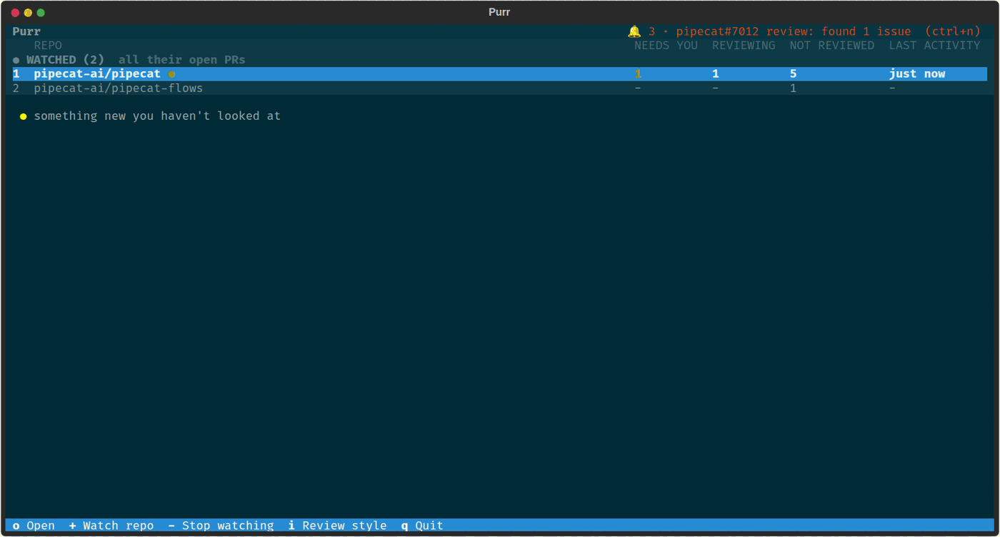

<h1><div align="center">
 
</div></h1>

[](https://github.com/pipecat-ai/purr/actions/workflows/tests.yaml) [](https://docs.pipecat.ai) [](https://discord.gg/pipecat)

# ᓚᘏᗢ Purr

**Purr** is a human-in-the-loop agentic code reviewer. It watches your GitHub repos, and
Claude reviews the pull requests assigned to you in the background. You read what it found,
ask it questions, and decide what gets posted. **Nothing goes to GitHub until you approve
it.**



## ✨ What it does

- **It reviews what's assigned to you** as it comes in, a few at a time. A quick planning
  step decides how deep: small changes get a quick look, risky ones a full review.
- **It knows what's waiting on you.** PRs are grouped: *Needs you* (a review to post, a
  question from the agent, someone replying to you on GitHub), *Reviewing*, *Review
  requested*, *Others reviewing*, *Done*, *Not reviewed*. News from other repos shows at the
  top.
- **Every review is a conversation.** You can keep talking to the agent about the PR ("is that
  race real?", "drop the nit"), and Purr suggests what to ask next.
- **You can comment on lines of the diff.** Your comments go out with the agent's, in one
  review.
- **Posting and merging are a key each.** `a` posts the review as you. `m` shows the checks,
  the other reviewers and any conflicts, then merges what you approved.
- **It follows several repos at once**, and recaps what happened while you were away.
- **It's safe by default.** The agents ask before doing anything risky, can run in a sandbox,
  and follow the repo's rules from its main branch, so a PR can't change what it's reviewed
  against.

## 🚀 Setup

You need a terminal on macOS, Linux or Windows, [uv](https://docs.astral.sh/uv/), the
[GitHub CLI](https://cli.github.com) and git. You don't need Claude Code: Purr runs its
agents with the [Claude Agent SDK](https://docs.claude.com/en/docs/agent-sdk/overview).

```sh
git clone git@github.com:pipecat-ai/purr.git
cd purr
uv sync
gh auth login        # GitHub: follow the prompts
uv run purr login    # Claude (skip it if you use Claude Code already)
uv run purr
```

Reviews use your Claude login, so they count against your Claude plan (or your API key, if you
set `ANTHROPIC_API_KEY`). To look around without starting any reviews, run
`uv run purr --no-auto-review`. To run `purr` from anywhere: `uv tool install --editable .`.

## 🧭 How to use it

1. **Pick a repo** at home (`enter`, or its number). Purr lists the repos with PRs assigned to
   you; `+` watches one, to see all its open PRs.
2. **Pick a PR.** On the right, its description, where it changes things, and the
   conversation with the agent. `r` reviews one that isn't yours yet (and assigns you).
3. **Talk to the agent** (`enter` goes to the prompt): ask, dig in, or change what it
   proposes. `tab` takes the suggestion.
4. **Read the diff** (`d`): it takes the list's place, next to the conversation. Select lines
   (`shift+↑`/`↓`) and press `enter` to ask the agent about them, or `c` to comment on them.
   `esc` or `d` closes it, `z` makes it full screen.
5. **Decide**: `a` posts the review with your comments, `x` dismisses it. Once you've
   approved, `m` merges.

When the agent asks before doing something risky, `a` allows it, `A` always, `x` says no (or
write what to do instead). When someone replies to you on GitHub, the PR is back in
*Needs you*: answer, or `x` if it needs no reply.

### ⌨️ Keys

The footer shows the keys for where you are. The main ones:

| Key | Does |
|---|---|
| `enter` / `o` / `tab` | Ask the agent / read the PR / switch between the list and the PR |
| `n` `p` / `/` | Next or previous PR / search |
| `r` / `space` | Review the PR / mark several first |
| `a` `x` / `A` | Approve or dismiss what's proposed (or allow or deny what's asked) / always allow |
| `d` / `D` | The diff, to read, ask about (`enter`) and comment on (`c`) / in your pager |
| `m` | Merge a PR you approved: once to see where it stands, again to merge |
| `t` / `z` | The agent's reasoning in full / full screen |
| `!` / `c` | A shell in the PR's checkout / its session in Claude Code (`/exit` comes back) |
| `ctrl+p` / `ctrl+n` / `w` | Find any repo or PR / the latest news / what happened while you were away |
| `i` | Your review style, code style, permissions, the repo's review skill, settings |
| `esc` / `q` | Back: from the search or the prompt to the list or the PR, then home / quit |

In the prompt: `ctrl+j` starts a new line, `↑` `↓` and `ctrl+r` go through what you asked,
and `/` lists commands: `/help`, `/review [quick|full]`, `/model`, `/cost`, `/compact`, and the
repo's own skills.

## 🎨 Make it yours

`i` edits these in your editor; they apply from the agent's next turn. Inside a repo, `i` edits
that repo's own versions instead.

| File | What it's for |
|---|---|
| `~/.config/purr/review.md` | How you like reviews: what to raise, what to skip, tone |
| `~/.config/purr/code.md` | What good code looks like to you; reviews hold PRs to it |
| `~/.config/purr/settings.toml` | Models, how often to poll, how many reviews at once, ... (`purr --help` for flags) |
| `~/.claude/settings.json` | What the agents may run without asking (the file Claude Code uses too) |

## 💡 Good to know

- **Purr never posts on its own.** The agents can read GitHub but not change it: they propose,
  and Purr posts what you approve, as you, signed "Sent from Purr."
- **The agents ask before anything risky.** Reading code and safe commands just run; anything
  else waits for your OK, and `A` keeps a rule so it doesn't ask again. This is the Agent SDK's
  permission system (Claude Code's, underneath), so the rules go in `~/.claude/settings.json`.
  `--sandbox` confines the agents' commands to the PR's checkout, on macOS and Linux (on
  Ubuntu 24.04+, AppArmor has to allow it, so it's off by default).
- **Costs.** `/cost` shows what each PR has cost. Quick reviews run on Sonnet;
  `--max-reviews 1` keeps things small.
- **Where things live**: the database, log and PR checkouts in `~/.local/share/purr`.
- **Copying**: drag over the PR pane. GNOME Terminal needs `wl-clipboard` (or `xclip`) for it.

## 🛠️ Development

```sh
uv run pytest                          # never calls GitHub or Claude
uv run ruff check && uv run ruff format
uv run python scripts/record_demo.py   # the GIF above, from made-up PRs
```

How Purr works and why: [`docs/purr.md`](docs/purr.md).

## 📄 License

BSD 2-Clause. See [LICENSE](LICENSE).
