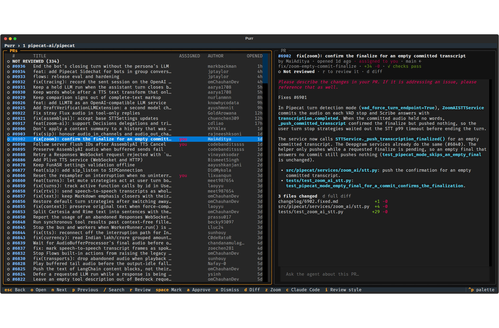

# Purr

A human-in-the-loop agentic code reviewer.

Purr watches your GitHub repos, and Claude reviews the pull requests assigned to you in the
background. You read what it found, ask it questions, and decide what gets posted.
**Nothing goes to GitHub until you approve it.**



- **Reviews happen on their own.** PRs assigned to you are reviewed as they come in, a few at
  a time. Small changes get a quick look; risky ones get a full review.
- **Each PR is a conversation.** Every review is a Claude Code session you can keep talking
  to: "is that race real?", "drop the nit", "make it a comment instead".
- **One key to post.** When you agree with the proposed review, `a` posts it as you.
- **Many repos, one place.** See what needs you everywhere, and catch up on what happened
  while you were away.

## Setup

You need a Mac or Linux terminal. It takes about five minutes.

### 1. Install the tools

| Tool | What for | Install |
|---|---|---|
| [uv](https://docs.astral.sh/uv/) | Runs Purr (and gets the right Python for you) | `curl -LsSf https://astral.sh/uv/install.sh \| sh` |
| [GitHub CLI](https://cli.github.com) | Reads PRs and posts your reviews | `brew install gh` (or see the link) |
| [Claude Code](https://docs.anthropic.com/en/docs/claude-code/setup) | Does the reviewing | `curl -fsSL https://claude.ai/install.sh \| bash` |
| git | Checks out the PRs | Probably already there: `git --version` |

### 2. Log in to both

```sh
gh auth login   # follow the prompts
claude          # log in when it asks, then type /exit
```

Purr uses your Claude Code login, so reviews count against your Claude plan (or your API key,
if you use `ANTHROPIC_API_KEY`).

### 3. Get Purr

```sh
git clone git@github.com:pipecat-ai/purr.git
cd purr
uv sync
```

### 4. Run it

```sh
uv run purr
```

The first time, Purr lists only the repos where PRs are assigned to you, under *Not watched*,
with just those PRs (you can review them all the same). To see all of a repo's open PRs,
watch it: select it and press `+`, or press `+` and type a repo like `pipecat-ai/pipecat`
(or paste its GitHub URL). If you start Purr inside a checkout of a repo, it offers to watch
that one.

Purr starts reviewing the PRs assigned to you right away. To look around first without
starting any reviews:

```sh
uv run purr --no-auto-review
```

> **Tip:** to run `purr` from anywhere, install it once with `uv tool install --editable .`
> from the `purr` folder.

## How to use it

1. **Home** lists the repos you watch, then the ones listed only for PRs assigned to you,
   with how many PRs need you in each. `enter` opens one (or press its number, `1` to `9`).
2. **A repo** shows its PRs on the left, grouped: *Needs you*, *Reviewing*, *Done* (the
   latest 5; `/` finds the rest), *Not reviewed*, and *Others reviewing*. A reviewed PR shows
   ✓ if the review found nothing and ● if it found issues; one being reviewed spins.
3. **Pick a PR** to read its description, files and diff on the right (`o` to scroll through
   it). Press `r` to review it (Purr also assigns it to you, so your teammates know).
4. **When the review is done**, read the findings and the review it proposes. `a` posts it,
   `x` dismisses it. To change it first, press `enter` and ask ("drop the second comment");
   it proposes again.
5. **If the agent asks for permission**: `a` allows it once, `A` always allows it (in this
   repo or everywhere), `x` says no. Claude Code decides what to ask about, as it does
   everywhere else (see below).

### Keys

| Where | Key | Does |
|---|---|---|
| Anywhere | `0` / `1`–`9` | Home / jump to a repo |
| | `ctrl+n` | Go to the latest news from another repo |
| | `ctrl+o` | Back to where you were |
| | `ctrl+p` | Find any repo or PR by name |
| | `w` | What happened while you were away |
| | `i` | Your review style, code style, permissions and the repo's review skill |
| | `q` / `ctrl+q` | Quit (it asks first) |
| | drag | Select text in the PR pane: it's copied |
| Home | `enter` / `+` / `-` | Open / watch / stop watching a repo |
| A repo | `enter` | Ask the agent about the PR: straight to its prompt |
| | `o` / `tab` | Read the PR / switch between the list and the PR |
| | `n` / `p` | Next / previous PR |
| | `/` | Search PRs |
| | `r` | Review the PR (`space` marks several first) |
| | `a` / `x` | Approve / dismiss what's proposed (or allow / deny what's asked) |
| | `A` | Always allow what's asked |
| | `d` | The full diff, in your pager |
| | `t` | The agent's reasoning in full (it's a line per thought otherwise) |
| | `!` | A shell in the PR's checkout, to run things yourself (`exit` to come back) |
| | `c` | Open the PR's conversation in Claude Code itself |
| | `z` | Full screen |
| | `esc` | Home, from anywhere in the repo (your search and anything typed stay) |
| The prompt | `enter` / `ctrl+j` | Send / new line |
| | `↑` `↓` / `ctrl+r` | Earlier messages / search them |
| | `/` | Commands (below) |

### Commands

Type them in a PR's prompt. Typing `/` lists them as you go.

| Command | Does |
|---|---|
| `/help` | Everything you can type here, including the repo's own skills |
| `/review [quick\|full]` | Start over with a fresh review |
| `/model [name]` | The model for this PR's conversation (`opus`, `sonnet`, ...) |
| `/cost` | What this PR's reviews and questions cost, and how long they took |
| `/shell`, `/claude` | Same as `!` and `c` |
| `/compact` | Shrink a long conversation so you can keep going |
| `/pipecat:prose-review`, ... | The repo's own Claude Code skills, if it has any |

## Safe by default

- **Purr never posts on its own.** The agents can read GitHub but can't change anything on
  it; they propose, and Purr posts only what you approve, as you, with a small
  "Sent from Purr." at the end.
- **Permissions are Claude Code's own.** Reviews run in Claude Code's auto mode, with your
  Claude Code settings: safe things run, and it asks before anything risky. When it asks, the
  PR shows up as needing you. `A` keeps Claude Code's suggested rule, for the repo or
  everywhere (your Claude Code settings). Purr adds only one rule: nothing that changes
  GitHub.
- **Optionally, a sandbox.** `uv run purr --sandbox` runs the agents' commands in Claude Code's
  sandbox, where your operating system confines them to the PR's checkout and a few sites
  (GitHub, PyPI, npm). On Ubuntu 24.04 and later, AppArmor blocks the sandbox unless you
  allow it, so it's off by default.
- **Repo rules come from the main branch.** The repo's `CLAUDE.md`, `AGENTS.md` and skills are
  read from its default branch, so a PR can't change the rules it's reviewed against.

## Make it yours

Press `i` to edit these in your editor. They apply to every review, from the next turn on.

| File | What it's for |
|---|---|
| `~/.config/purr/review.md` | How you like reviews: what to raise, what to skip, tone |
| `~/.config/purr/code.md` | What good code looks like to you; reviews hold PRs to it |
| `~/.claude/settings.json` | Your Claude Code permissions, which reviews use too (`i`, `p`) |

Inside a repo, `i` edits that repo's own versions instead: its review and code style, the
permissions you allowed for its reviews, and which of its skills reviews follow (for pipecat,
its `code-review` skill is used automatically).

## Good to know

- **Costs.** Reviews use your Claude plan or API key. A cheap planning step decides how deep
  each review goes; quick reviews run on Sonnet. `/cost` shows what each PR has cost so far.
  To keep things small, run `uv run purr --max-reviews 1`.
- **Where things live.** The database, log (`purr.log`) and PR checkouts are in
  `~/.local/share/purr` (or `--data-dir`). A PR's checkout is removed once you approve it or
  it closes, unless it has changes of yours in it.
- **Copying.** Selecting text with the mouse copies it. GNOME Terminal (and other terminals
  built on VTE) don't let apps copy, so there install `wl-clipboard` (or `xclip`) first;
  `shift`+drag always selects with the terminal itself.
- **Options.** `uv run purr --help` lists them: `--no-auto-review`, `--max-reviews N`,
  `--permission-mode MODE`, `--sandbox`, `--data-dir`, `--headless`, `-v`.

## Development

```sh
uv run pytest        # the tests never call GitHub or Claude
uv run ruff check .
uv run ruff format .
```

How Purr works and why: [`purr.md`](purr.md).
